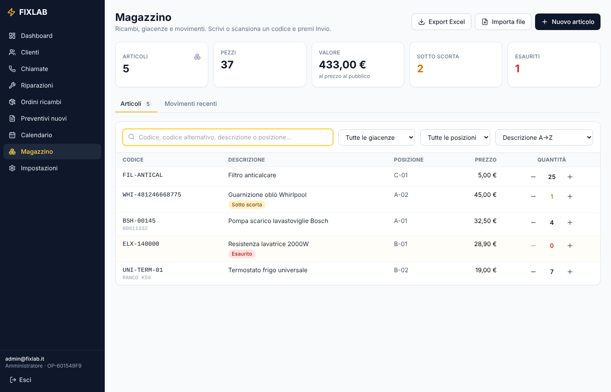

# FixLab — gestionale assistenza e magazzino

Gestionale per il laboratorio di riparazione elettrodomestici: clienti, chiamate, riparazioni, ordini ricambi,
preventivi, calendario e magazzino. Frontend React (Vite) + backend Node/Express su PostgreSQL, pubblicato su Railway.

## Interfaccia (v2)



- **Dashboard**: appuntamenti di oggi, urgenze, interventi assegnati a me, articoli sotto scorta, avviso se il backup non è attivo.
- **Chiamate / Riparazioni / Ordini ricambi / Preventivi**: elenco con stato, urgenza, operatore e ricerca; scheda con note firmate,
  foto/documenti, diagnosi AI, **ricambi scaricati dal magazzino** collegati all'intervento, conversione chiamata → riparazione.
- **Clienti**: ricerca istantanea, scheda con storico interventi, chiamata e mappa con un tocco, creazione rapida dagli interventi.
- **Calendario**: settimana/giorno/mese/elenco, trascina per spostare, clic su uno spazio libero per creare.
- **Magazzino**: ricerca anche da lettore di codici a barre (Invio apre l'articolo o propone di crearlo), +/− rapidi,
  carico/scarico con causale, storico movimenti, import con anteprima, export per Excel.
- **Impostazioni**: utenti e richieste di accesso, backup, codice operatore, recupero dei dati rimasti nel browser dalla vecchia versione.

Percorsi: `#/dashboard`, `#/clienti`, `#/chiamate`, `#/riparazioni`, `#/ordini`, `#/preventivi`, `#/calendario`, `#/magazzino`, `#/impostazioni`.

## Struttura

```
server/            backend v2 (Express + pg, SQL esplicito)
  index.js         avvio, seed admin, backup pianificato
  app.js           creazione app (usata anche dai test)
  routes/          auth, admin, customers, tickets, interventions, inventory, calendar, ai, legacy
  services/        google (Drive/Calendar), backup, settings
  middleware/      autenticazione JWT + CSRF, sicurezza, rate limit
prisma/migrations/ migrazioni SQL (applicate con `prisma migrate deploy`)
src/               frontend React
  lib/             client API, routing, formattazione, vocabolario del dominio
  components/      UI di base, selettore clienti
  pages/           Dashboard, Clienti, Interventi, Calendario, Magazzino, Impostazioni
tests/             test automatici del backend (database Postgres reale)
```

Tutti i dati stanno su **PostgreSQL**. Il vecchio server scriveva una parte dei dati (ticket, import CSV, export CSV)
in un file SQLite sul disco temporaneo di Railway, che si cancella a ogni deploy: non succede più.

## Variabili d'ambiente (Railway)

| Variabile | Obbligatoria | Note |
|---|---|---|
| `DATABASE_URL` | sì | Postgres di Railway |
| `JWT_SECRET`, `JWT_REFRESH_SECRET` | sì | stringhe casuali lunghe; senza, il server non parte |
| `ADMIN_EMAIL`, `ADMIN_PASSWORD` | consigliate | l'admin viene creato/allineato all'avvio |
| `PUBLIC_URL` | no | URL pubblico (su Railway viene ricavato da `RAILWAY_PUBLIC_DOMAIN`) |
| `GOOGLE_OAUTH_CLIENT_ID`, `GOOGLE_OAUTH_CLIENT_SECRET` | per Google | collegamento dell'account Google del negozio (Drive + Calendar) |
| `GOOGLE_SERVICE_ACCOUNT_EMAIL`, `GOOGLE_SERVICE_ACCOUNT_PRIVATE_KEY(_BASE64)` | alternativa | service account (non salva su Drive di account Gmail personali) |
| `GOOGLE_DRIVE_FOLDER_ID` / `GOOGLE_DRIVE_FOLDER_NAME` | no | cartella dei backup |
| `BACKUP_INTERVAL_HOURS` | no | default 24 |
| `DEEPSEEK_API_KEY`, `DEEPSEEK_API_URL`, `RAG_API_URL` | no | assistente AI (le chiavi restano sul server) |
| `ENABLE_DESTRUCTIVE_OPERATIONS` | no | abilita il ripristino completo da backup (`/api/import`) |
| `API_RATE_LIMIT_MAX` | no | richieste per utente ogni 15 minuti (default 1500) |

## Backup

- Automatico ogni `BACKUP_INTERVAL_HOURS` su Google Drive, con **tutte** le tabelle (clienti, ticket, interventi,
  storico, note, calendario, magazzino, movimenti, utenti).
- Se Google non è collegato lo stato è **`not_configured`**: il backup **non** è stato salvato. (Prima veniva mostrato
  come "degraded", che sembrava un backup riuscito a metà.)
- Un service account Google non ha spazio su Drive: con un account Gmail personale bisogna collegare l'account
  del negozio con OAuth (`GOOGLE_OAUTH_*`) oppure usare un Drive condiviso (Google Workspace).
- Export manuale sempre disponibile: Impostazioni → Export JSON / CSV.

## Google Calendar (ponte bidirezionale)

Impostazioni → Google → **Collega account Google** (una volta sola), poi scegli calendario e tipi da sincronizzare.

- **Gestionale → Google**: ogni intervento dei tipi scelti (predefinito: chiamate) diventa un evento con cliente, telefono,
  indirizzo, descrizione e link alla scheda. Spostamenti, completamenti (✔) e annullamenti vengono propagati in pochi secondi.
  Colori: chiamata blu, riparazione viola, ordine arancio, preventivo verde, urgente rosso, completato grigio.
- **Google → gestionale**: lettura incrementale ogni `CALENDAR_SYNC_INTERVAL_MINUTES` (default 5). Un evento del gestionale
  spostato su Google sposta l'appuntamento (con nota nello storico); gli eventi creati su Google compaiono nel calendario dell'app.
  Un evento di intervento cancellato a mano su Google non viene ricreato (si può forzare con "Ricreali").
- Ogni 6 ore un giro completo recupera eventuali modifiche perse. Tutte le operazioni sono in coda unica (niente doppioni).

Configurazione Google Cloud: abilita Calendar API e Drive API, crea un *ID client OAuth* (applicazione web) con URI di
reindirizzamento `https://<dominio>/api/google/callback`, pubblica la schermata di consenso (altrimenti il collegamento scade
dopo 7 giorni) e imposta `GOOGLE_OAUTH_CLIENT_ID` / `GOOGLE_OAUTH_CLIENT_SECRET` su Railway. Il refresh token è salvato
cifrato (AES-256-GCM) nel database.

## Magazzino (API)

| Metodo | Percorso | Descrizione |
|---|---|---|
| GET | `/api/inventory?q=&stock=low\|out\|available&location=&sort=&order=&skip=&take=` | ricerca per codice, codici alternativi, descrizione, posizione (più parole = tutte devono comparire) |
| GET | `/api/inventory/summary` | articoli, pezzi, valore, sotto scorta, esauriti, posizioni |
| GET | `/api/inventory/:id` | scheda con ultimi 100 movimenti |
| POST | `/api/inventory` | nuovo articolo (codice duplicato → 409 `code_exists`) |
| PUT | `/api/inventory/:id` | modifica con controllo di versione (409 `conflict` se modificato da altri) |
| POST | `/api/inventory/:id/movements` | carico/scarico atomico `{delta, reason, note, interventionId}`; giacenza negativa → 409 |
| GET | `/api/inventory/movements?interventionId=` | ultimi movimenti |
| POST | `/api/inventory/import` | import `{csv}` o `{rows}`, `mode: add` (somma) o `set` (inventario), `dryRun` per l'anteprima |
| GET | `/api/inventory/export.csv` | export per Excel (separatore `;`, virgola decimale) |

Il file Excel/CSV usa le intestazioni del negozio: `POSIZIONE; CODICE; DESCRIZIONE; PREZZO AL PUBBLICO; QUANTITA`
(opzionali `SCORTA MINIMA`, `CODICI ALTERNATIVI`). L'export si può re-importare così com'è.

## Sviluppo

```bash
pnpm install
pnpm server        # backend su :3000 (serve DATABASE_URL e JWT_* nel .env)
pnpm dev           # frontend Vite, inoltra /api al backend
pnpm test          # test backend: serve un Postgres locale (TEST_DATABASE_ADMIN_URL)
pnpm build
```

I test creano un database temporaneo, applicano tutte le migrazioni e lo eliminano alla fine.
`TEST_DATABASE_ADMIN_URL` deve puntare a un utente che può creare database (default
`postgresql://postgres@localhost:5433/postgres?host=/tmp`).

## Deploy su Railway

`railway.json`: build `pnpm run build`, avvio `prisma migrate deploy && node server/index.js`, healthcheck `/healthz`.
Le migrazioni v2 sono solo additive (nuove tabelle e indici) e non modificano i dati esistenti.

Promuovere un utente ad admin: `node scripts/promote-user-admin.js email@esempio.it`.

## Sicurezza

- Il file `.env` non va mai committato (è in `.gitignore`).
- Sessione con cookie HttpOnly (access 15 min + refresh 14 giorni ruotato) e token CSRF per ogni modifica.
- Ruoli: `ADMIN` (tutto), `OPERATOR` (lavoro quotidiano), `VIEWER` (sola lettura).
